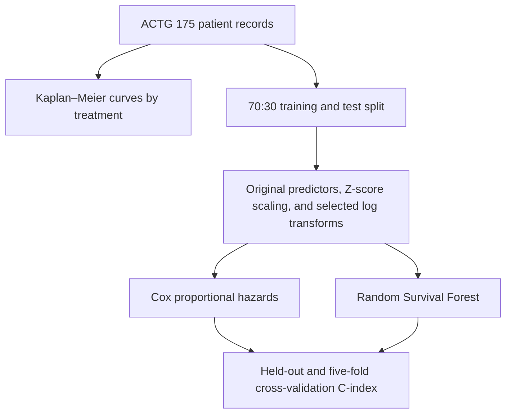

# HIV Clinical Progression Prediction

**Comparing Cox proportional hazards regression and Random Survival Forest using ACTG Study 175**

How well can baseline patient characteristics predict who is likely to experience HIV clinical progression sooner? This project compares two survival-analysis models and evaluates whether scaling or log-transforming predictors improves their ability to rank patients by event risk.

## Study at a glance

| Patient records | Observed events | Right-censored records | Encoded baseline predictors |
| :---: | :---: | :---: | :---: |
| **2,139** | **521 (24.36%)** | **1,618 (75.64%)** | **19** |

The composite endpoint included a substantial decline in CD4 T-cell count, progression to AIDS, or death. Baseline predictors included CD4 and CD8 counts, symptoms, functional status, and treatment indicators.

## Analysis workflow

Kaplan–Meier curves described event-free survival by treatment group. Model discrimination was assessed using the **concordance index (C-index)**, which measures how well a model ranks patients by event risk while accounting for censoring.

## Model performance

| Evaluation | Cox PH | Random Survival Forest |
| :--- | ---: | ---: |
| Held-out test · Original predictors | **0.6685** | 0.6295 |
| Held-out test · Selected log transformations | **0.6704** | 0.6295 |
| Held-out test · Z-score standardization | **0.6685** | 0.6295 |
| Mean five-fold cross-validation · Original predictors | **0.6822** | 0.6478 |

Cox PH achieved higher discrimination in every comparison, though both models performed moderately. Selected log transformations increased the Cox PH test C-index by just **0.0019**, and RSF returned the same test C-index across all three preprocessing approaches.

## What the models found

- **Baseline CD4 count** ranked highest in the RSF permutation importance analysis. Treatment group and symptoms also contributed to predictions.
- **Treatment regimen** was associated with event hazard in the Cox PH model. The hazard-ratio estimates were lower for each of the three alternative regimens relative to zidovudine alone.

## Limitations and next steps

These results come from a secondary analysis of a single trial dataset. The C-index measures how well a model ranks patients by risk. Calibration requires a separate assessment of how closely predicted event probabilities match observed outcomes. Before clinical use, the models would need calibration assessment and independent validation. The Cox PH model also requires checks of the proportional hazards assumption.
